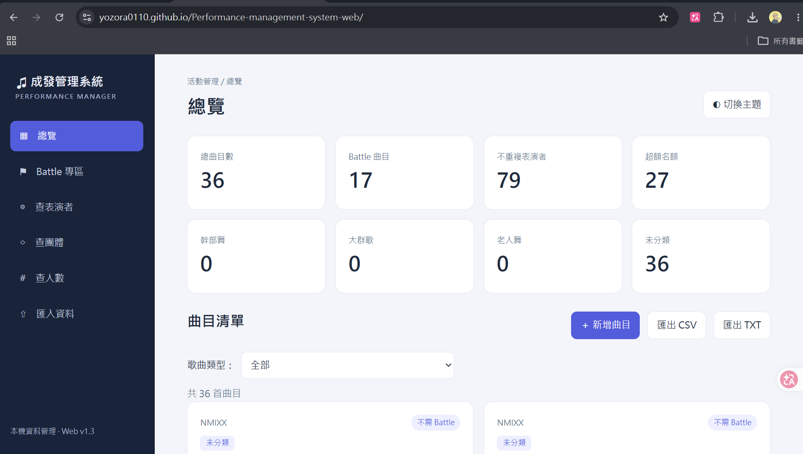
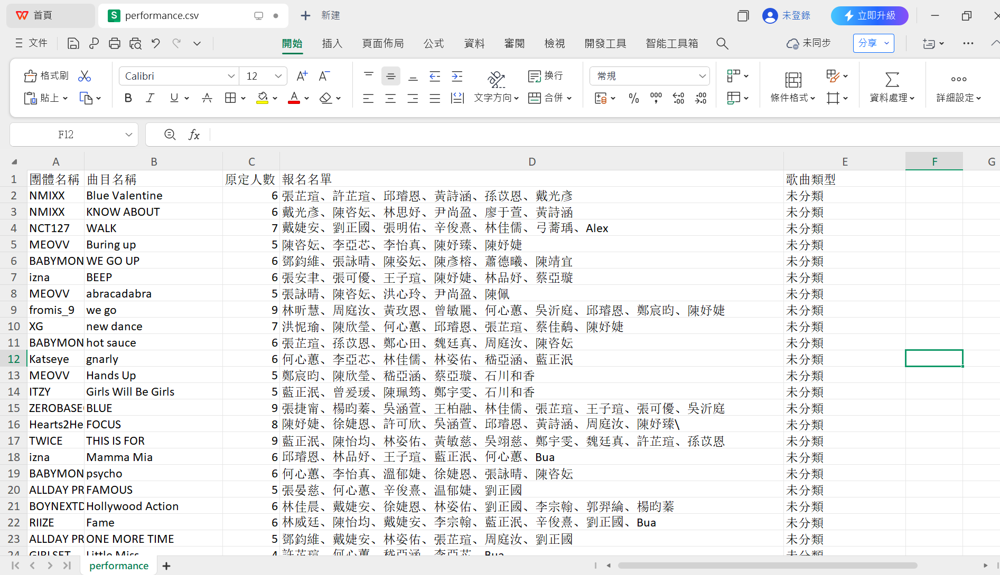

# 成發表演曲目管理系統 Web

本專案為原始 C# Windows Forms 成發表演曲目管理系統的延伸版本，使用 HTML、CSS 與 JavaScript 開發，並針對實際活動管理需求進行功能擴充與介面優化。


## 線上體驗（Live Demo）

[](https://yozora0110.github.io/Performance-management-system-web/)

- [網頁版線上體驗](https://yozora0110.github.io/Performance-management-system-web/)
- [原始 C# 桌面版專案](https://github.com/yozora0110/Performance-management-system)

無需安裝額外軟體，直接透過瀏覽器即可使用。

---

## 目錄

- [一、設計初衷](#一設計初衷)
- [二、網頁版新增功能](#二網頁版新增功能)
  - [1. 歌曲分類與篩選](#1-歌曲分類與篩選)
  - [2. 不重複表演者統計](#2-不重複表演者統計)
  - [3. 曲目新增、修改與刪除](#3-曲目新增修改與刪除)
  - [4. 本機資料自動儲存](#4-本機資料自動儲存)
  - [5. 使用者介面優化](#5-使用者介面優化)
  - [6. 多格式檔案匯入](#6-多格式檔案匯入)
  - [7. 資料匯出功能](#7-資料匯出功能)
- [三、新舊版本比較](#三新舊版本比較)
- [四、開發技術](#四開發技術)
- [五、操作方式](#五操作方式)
- [六、匯入檔案格式](#六匯入檔案格式)
- [七、使用限制與專案心得](#七使用限制與專案心得)

---

## 一、設計初衷

最初，我使用 C# Windows Forms 開發成發表演曲目管理系統，希望減少幹部人工整理報名名單、統計人數及查詢曲目所花費的時間。

然而，原始版本較著重於基本功能的實作，介面較為簡單，且原專案主要透過 Visual Studio 啟動。對於不熟悉程式開發工具的幹部而言，使用上較不方便。

因此，我決定在 AI 工具的協助下，嘗試將原本的桌面應用程式延伸為網頁版本，並重新思考實際活動中需要的功能，改善原本系統的不足。

透過網頁化，使用者只需要開啟網址即可操作系統，也更方便將這套工具交接給下一屆幹部，讓專案不只是一次性的程式設計作品，而是能夠持續使用的活動管理工具。

<p align="right">
  <a href="#目錄">↑ 返回目錄</a>
</p>

---

## 二、網頁版新增功能

網頁版保留原始版本的曲目總覽、Battle 自動判斷、表演者查詢、團體查詢及人數篩選等功能，並加入以下改善。

### 1. 歌曲分類與篩選

由於成發活動中，不同類型的歌曲具有不同的報名對象及活動規則，因此新增歌曲分類功能：

- 幹部舞
- 大群歌
- 老人舞
- 未分類

使用者可以在匯入時指定歌曲類型，也可以事後修改分類，方便幹部針對不同類型的歌曲進行管理、統計與查詢。

目前各類型仍採用相同的 Battle 判斷方式。

---

### 2. 不重複表演者統計

同一位表演者可能同時報名多首歌曲，因此直接加總各首歌曲的報名人數，並不能得知實際參與活動的人數。

網頁版能夠自動統計所有曲目中不重複的表演者姓名，讓負責人不需要逐一核對名單，即可快速掌握整體參與人數。

例如：

| 曲目 | 報名人員 |
| --- | --- |
| 歌曲 A | 成員甲、成員乙、成員丙 |
| 歌曲 B | 成員乙、成員丙、成員丁 |

總報名人次為 6 人次，但不重複表演者為 4 人。

---

### 3. 曲目新增、修改與刪除

原始版本主要提供資料匯入與查詢，若需要修改內容，必須重新編輯原始檔案。

網頁版新增 CRUD 資料管理功能，可以直接：

- 新增或刪除曲目。
- 修改團體及歌曲名稱。
- 調整原定人數。
- 修改報名人員名單。
- 更改歌曲類型。

修改後，系統會即時更新統計資訊及 Battle 狀態，不需要重新匯入整份檔案。

---

### 4. 本機資料自動儲存

網頁版使用 LocalStorage 儲存使用者的資料。

即使關閉網站或重新整理頁面，再次使用相同瀏覽器開啟網站時，仍然可以保留前一次未清空的資料，不需要每次重新匯入及設定。

首次開啟網站時不包含任何預設名單，使用者也可以手動清空所有曲目資料。

---


### 5. 使用者介面優化

相較於原始版本較為簡單的操作介面，網頁版採用現代化 Dashboard 管理介面，讓整體版面更加清楚、直觀。

主要改善包含：

- 側邊導覽列。
- 統計儀表板。
- 曲目卡片及歌曲分類標示。
- 報名人數進度條。
- Battle 狀態及超額人數提示。
- 深色與淺色模式切換。
- 支援電腦、平板及手機的響應式版面。

使用者可以直接從統計儀表板掌握總曲目數、不重複表演者人數、Battle 曲目數、超額名額及各類型歌曲數量。

#### 實際執行畫面

以下為匯入 36 首曲目後的系統總覽畫面，系統自動統計出 17 首需要 Battle 的曲目、79 位不重複表演者及 27 個超額名額。



---

### 6. 多格式檔案匯入

原始版本僅支援 TXT 文字檔，網頁版則同時支援 TXT 與 CSV 格式，讓使用者也可以透過 Excel 等試算表工具整理資料。

另外新增：

- 拖曳檔案匯入。
- 匯入時指定歌曲類型。
- 追加匯入或取代原有資料。

當不同類型的歌曲分別存放於不同檔案時，可以透過追加匯入功能將資料整合至同一個系統，不需要事先手動合併檔案。

---


### 7. 資料匯出功能

完成曲目及報名資料整理後，可以將全部曲目匯出為 TXT 或 CSV 檔案，並保留歌曲類型。

此功能方便後續進行：

- 活動資料彙整。
- 報名名單備份。
- 試算表編輯。
- 資料重新匯入。
- 下一屆幹部資料交接。

#### CSV 匯出成果

以下為系統實際匯出的 CSV 檔案，使用試算表軟體開啟後，可以清楚查看團體名稱、曲目名稱、原定人數、報名名單及歌曲類型，方便後續資料整理與交接。



<p align="right">
  <a href="#目錄">↑ 返回目錄</a>
</p>

---

## 三、新舊版本比較

| 功能 | C# 桌面版 | Web 網頁版 |
| --- | :---: | :---: |
| 透過網址直接使用 | — | ✔ |
| 曲目總覽 | ✔ | ✔ |
| Battle 自動判斷 | ✔ | ✔ |
| 表演者、團體及人數查詢 | ✔ | ✔ |
| TXT 檔案匯入 | ✔ | ✔ |
| CSV 檔案匯入 | — | ✔ |
| 匯入資料預覽 | ✔ | ✔ |
| 歌曲分類與篩選 | — | ✔ |
| 不重複表演者統計 | — | ✔ |
| 超額名額統計 | — | ✔ |
| 曲目新增、修改與刪除 | — | ✔ |
| 本機資料自動儲存 | — | ✔ |
| 拖曳檔案匯入 | — | ✔ |
| 追加匯入資料 | — | ✔ |
| TXT、CSV 資料匯出 | — | ✔ |
| Dashboard 統計介面 | — | ✔ |
| 報名人數進度條 | — | ✔ |
| 深色與淺色模式 | — | ✔ |
| 響應式網頁設計 | — | ✔ |

<p align="right">
  <a href="#目錄">↑ 返回目錄</a>
</p>

---

## 四、開發技術

| 技術 | 用途 |
| --- | --- |
| HTML | 建立網頁結構 |
| CSS | 介面美化與版面設計 |
| JavaScript | 資料處理及系統功能 |
| LocalStorage | 瀏覽器本機資料儲存 |
| GitHub Pages | 網站部署與託管 |

本專案採用純前端架構，所有資料處理皆在使用者的瀏覽器中完成，不需要額外架設後端伺服器或資料庫。

網頁版主要透過 AI 工具協助實作，並依照實際活動需求進行功能規劃、調整及介面改善。

<p align="right">
  <a href="#目錄">↑ 返回目錄</a>
</p>

---

## 五、操作方式

1. 開啟網頁版線上體驗網址。
2. 點選側邊導覽列的「匯入資料」。
3. 選擇歌曲類型及匯入方式。
4. 匯入 TXT 或 CSV 檔案。
5. 確認預覽資料後產生曲目卡片。
6. 使用各項查詢、分類及編輯功能。
7. 完成整理後，可匯出 TXT 或 CSV 檔案。

也可以下載完整專案，直接透過瀏覽器開啟 `index.html` 使用。

<p align="right">
  <a href="#目錄">↑ 返回目錄</a>
</p>

---

## 六、匯入檔案格式

檔案需使用 UTF-8 編碼，支援 TXT 與 CSV 格式。

### TXT 格式

相容原始桌面版本：

```text
團體名稱-曲目名稱/原定人數/報名名單
```

新版可在最後加入歌曲類型：

```text
NMIXX-Blue Valentine/6/成員A、成員B/幹部舞
RIIZE-Fame/6/成員C、成員D/大群歌
aespa-Supernova/4/成員E、成員F/老人舞
```

### CSV 格式

```csv
團體名稱,曲目名稱,原定人數,報名名單,歌曲類型
NMIXX,Blue Valentine,6,成員A、成員B,幹部舞
RIIZE,Fame,6,成員C、成員D,大群歌
aespa,Supernova,4,成員E、成員F,老人舞
```

使用 Excel 整理資料後，可另存為 CSV UTF-8 格式，再匯入系統。

若原始檔案未指定歌曲類型，也可以在匯入時統一設定。

<p align="right">
  <a href="#目錄">↑ 返回目錄</a>
</p>

---

## 七、使用限制與專案心得

### 目前使用限制

- 資料儲存於目前使用的瀏覽器，無法跨裝置同步。
- 尚未支援多人共同編輯。
- 尚未提供帳號登入及權限管理。
- 追加匯入不會自動合併重複曲目。
- 表演者人數以姓名作為統計依據。
- 清除瀏覽器網站資料可能造成名單遺失，建議定期匯出備份。

### 專案心得

在開發原始 C# 版本時，我主要著重於程式功能的實現；而在延伸網頁版本的過程中，我開始從使用者的角度思考，了解原本系統有哪些不足，以及如何改善操作體驗與資料管理方式。

透過 AI 工具的協助，我嘗試將自己的功能需求與設計構想轉化為實際可操作的網站，也進一步認識網頁開發、本機資料儲存及網站部署等概念。

我認為這次專案最有價值的地方，不只是增加更多功能，而是將原本的程式設計作品轉化為能夠解決實際問題，並讓下一屆幹部持續使用的管理工具。

<p align="right">
  <a href="#目錄">↑ 返回目錄</a>
</p>
